# Feles

Feles is a set of soft, dark and light themes in seven cat coats:

| Coat | Accent |
|---|---|
| **Cinnamon** | Cherrywood Red |
| **Russian Blue** | Teal |
| **Siamese** | JetBrains Blue |
| **Marmalade** | Gold |
| **Lilac** | Lavender |
| **Chartreux** | Sage |
| **Tuxedo** | Silver |

All seven share the same low-contrast UI and italics, and each comes in a `Dark` and a `Light` version.

To install:
  1.  Open Extensions on the sidebar.
  2.  Search for Feles.
  3.  Install & reload.
  4.  ⌘ + ⇧ + P and type "Color Theme".
  5.  Pick a Feles theme from the list, for example `Feles Siamese Dark`, and hit enter.

To switch between the dark and light version with your system theme, add this to your settings:

```json
"window.autoDetectColorScheme": true,
"workbench.preferredDarkColorTheme": "Feles Siamese Dark",
"workbench.preferredLightColorTheme": "Feles Siamese Light"
```

### Coming from Gatito Nightly

Feles used to be called Gatito Nightly. The Red and Blue themes are now Cinnamon and Russian Blue, and keep their old setting names so existing settings keep working:

| Theme | Setting name |
|---|---|
| Feles Cinnamon Dark | `Gatito Nightly Red` |
| Feles Cinnamon Light | `Gatito Daylight Red` |
| Feles Russian Blue Dark | `Gatito Nightly Blue` |
| Feles Russian Blue Light | `Gatito Daylight Blue` |

Use these names for Cinnamon and Russian Blue in settings like `workbench.preferredDarkColorTheme`.

### Siamese

Siamese is inspired by JetBrains IDEs. It uses the JetBrains blue accent and the code colors of JetBrains' Islands Dark and IntelliJ Light schemes, including their semantic highlighting: fields in purple, declarations colored and calls left plain.

For the full look, these settings go well with it:

```json
"editor.fontFamily": "JetBrains Mono",
"editor.fontLigatures": true,
"workbench.tree.indent": 12,
"editor.bracketPairColorization.enabled": false
```

### Marmalade

Marmalade pairs its gold accent with the code colors of [Ayu](https://github.com/ayu-theme/vscode-ayu).

### Lilac

Lilac pairs its lavender accent with the code colors of [Catppuccin](https://github.com/catppuccin/vscode): Mocha for the dark version and Latte for the light one.

### Chartreux

Chartreux pairs its sage accent with the code colors of [Everforest](https://github.com/sainnhe/everforest-vscode).

### Tuxedo

Tuxedo is the quiet one: a silver accent and the code colors of [Alabaster](https://github.com/tonsky/sublime-scheme-alabaster), which only highlights strings, constants, comments and definitions, and leaves keywords, types and calls in the text color.

### Credits

Feles started as a fork of [Gatito Theme](https://github.com/pawelgrzybek/gatito-theme). Siamese's code colors come from the JetBrains Islands Dark and IntelliJ Light schemes, Marmalade's from [Ayu](https://github.com/ayu-theme/vscode-ayu), Lilac's from [Catppuccin](https://github.com/catppuccin/vscode), Chartreux's from [Everforest](https://github.com/sainnhe/everforest-vscode) and Tuxedo's from [Alabaster](https://github.com/tonsky/sublime-scheme-alabaster).

**Enjoy!**

### Previews

#### Feles Cinnamon Dark

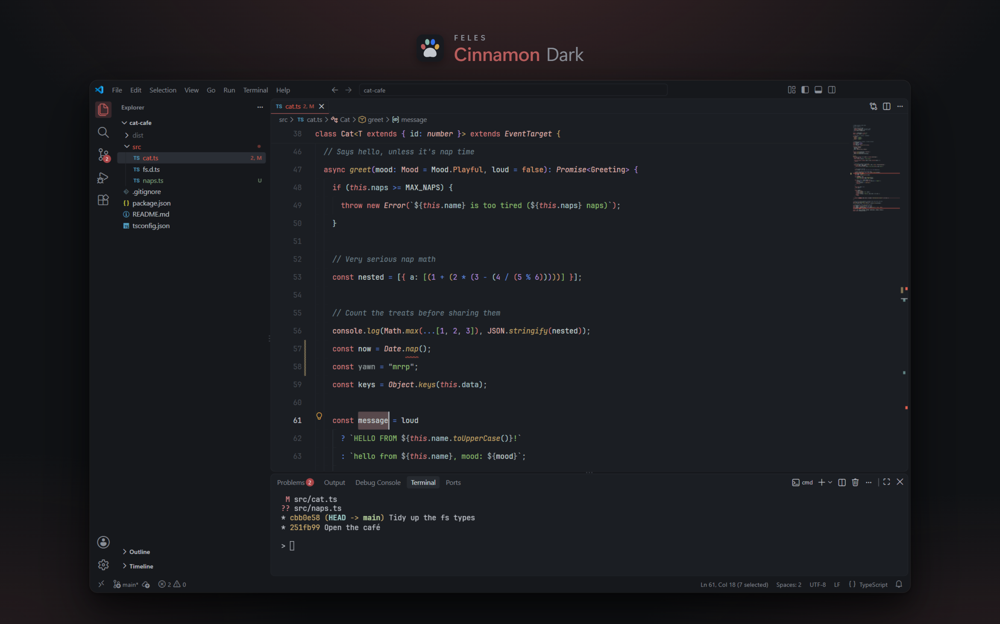

#### Feles Cinnamon Light

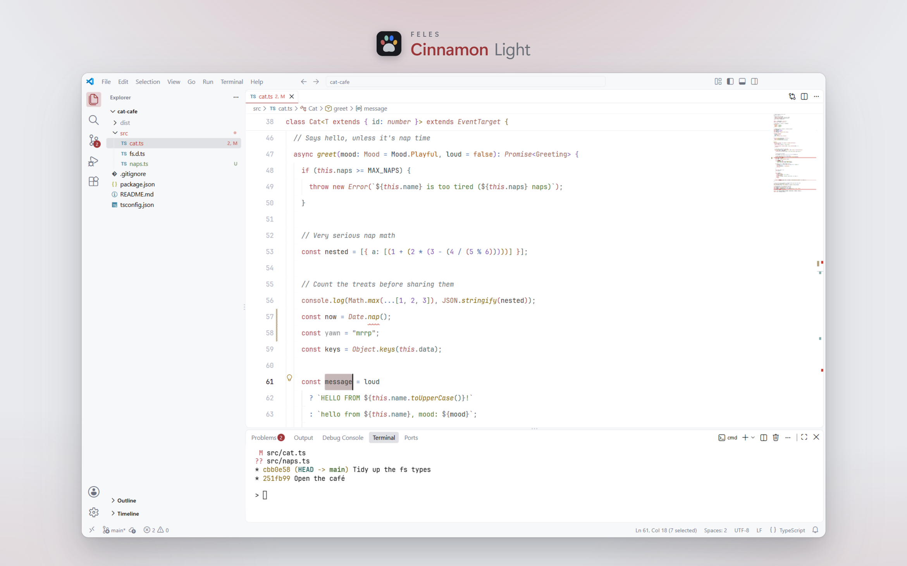

#### Feles Russian Blue Dark

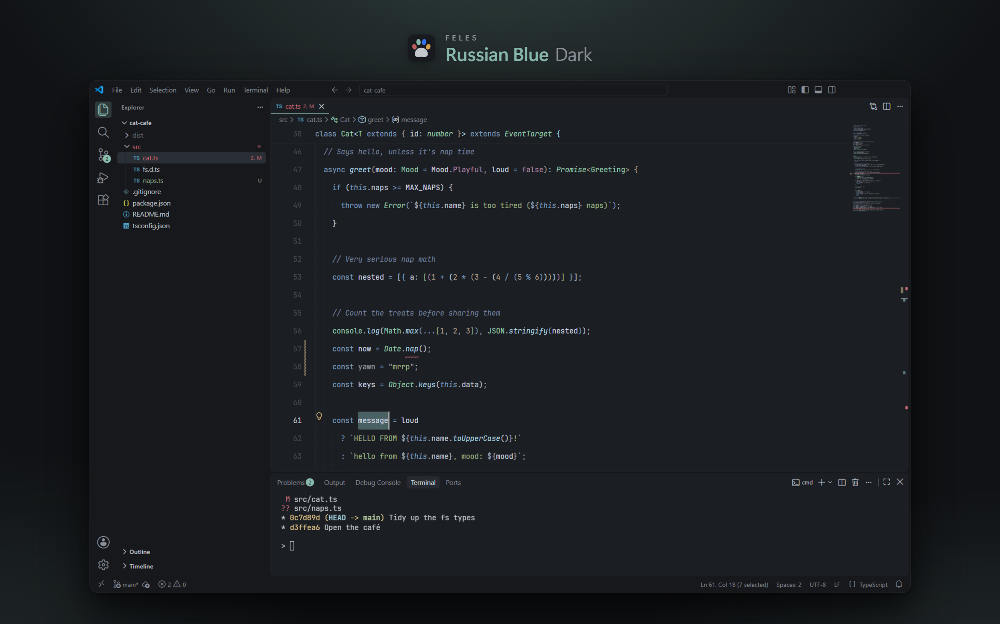

#### Feles Russian Blue Light

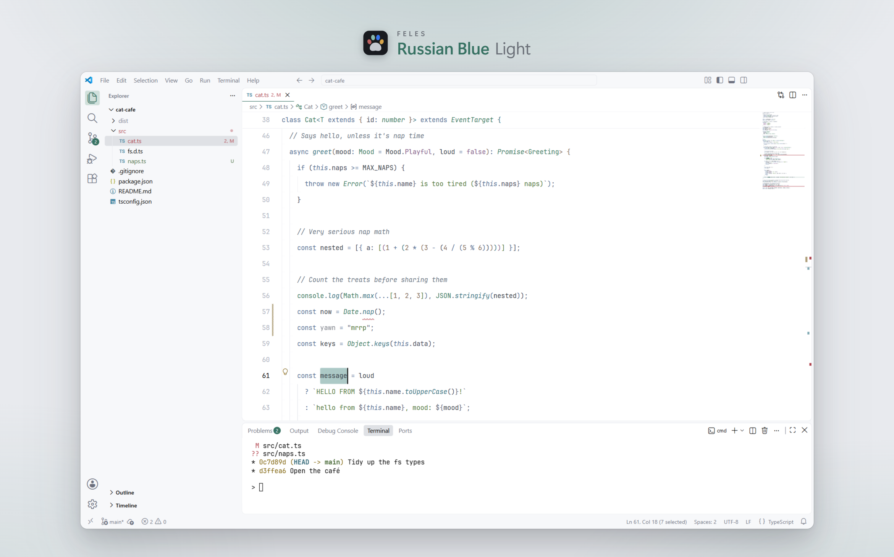

#### Feles Siamese Dark

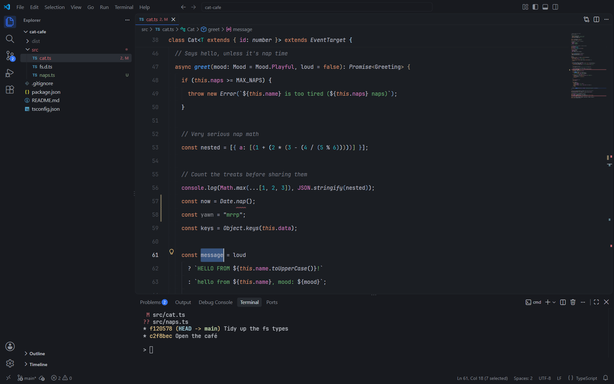

#### Feles Siamese Light

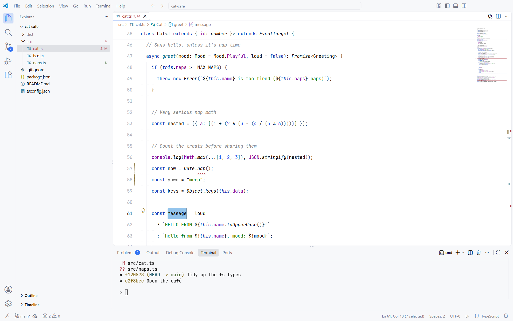

#### Feles Marmalade Dark

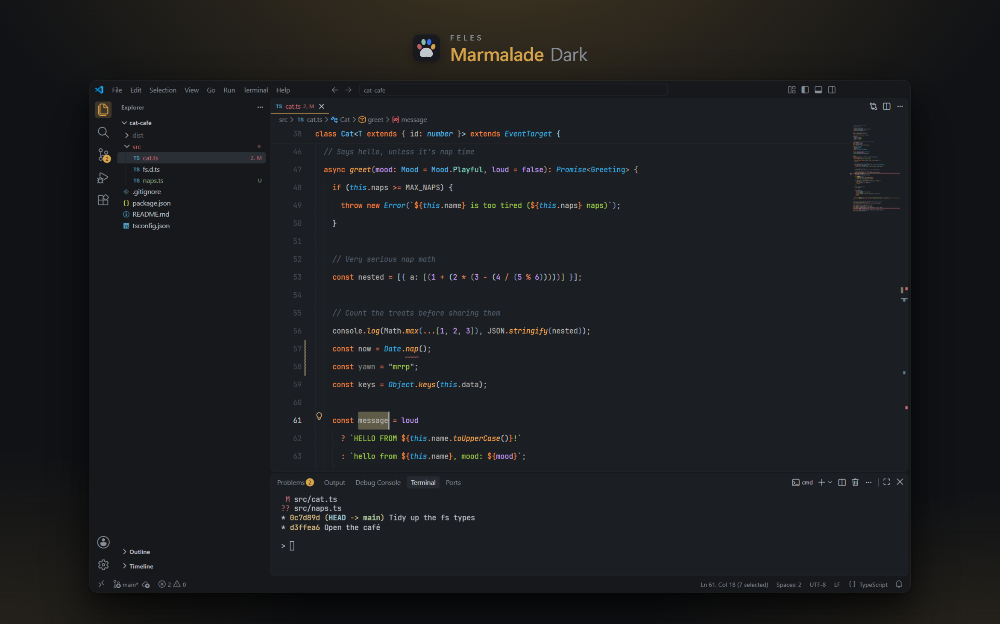

#### Feles Marmalade Light

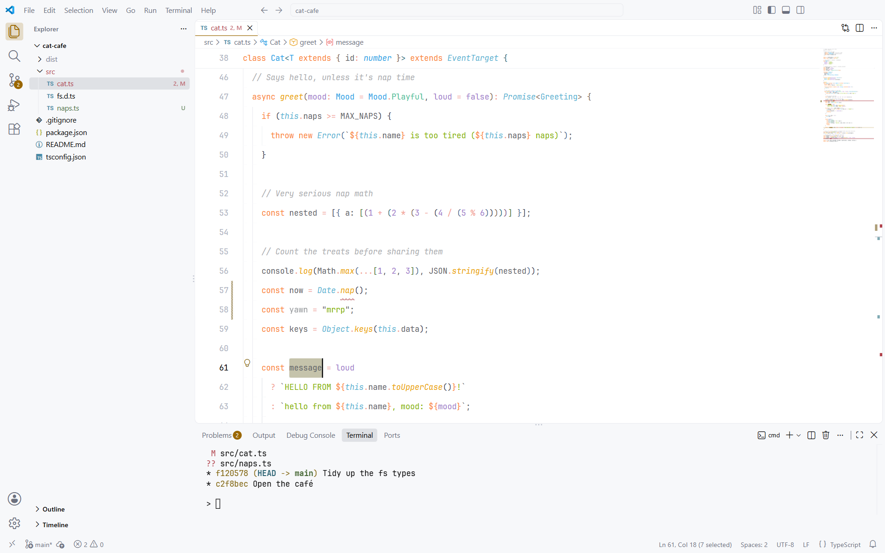

#### Feles Lilac Dark

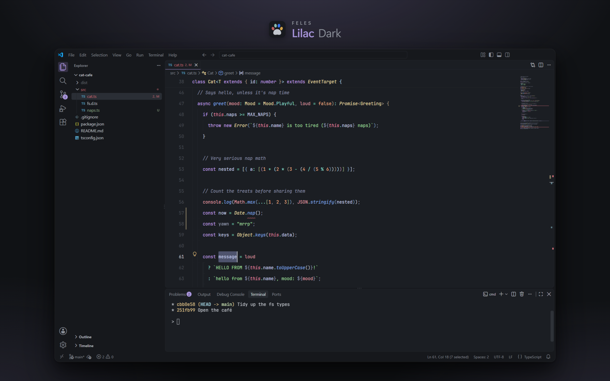

#### Feles Lilac Light

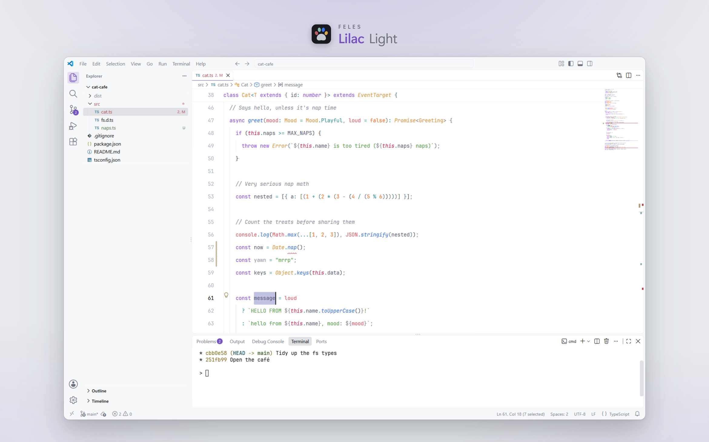

#### Feles Chartreux Dark

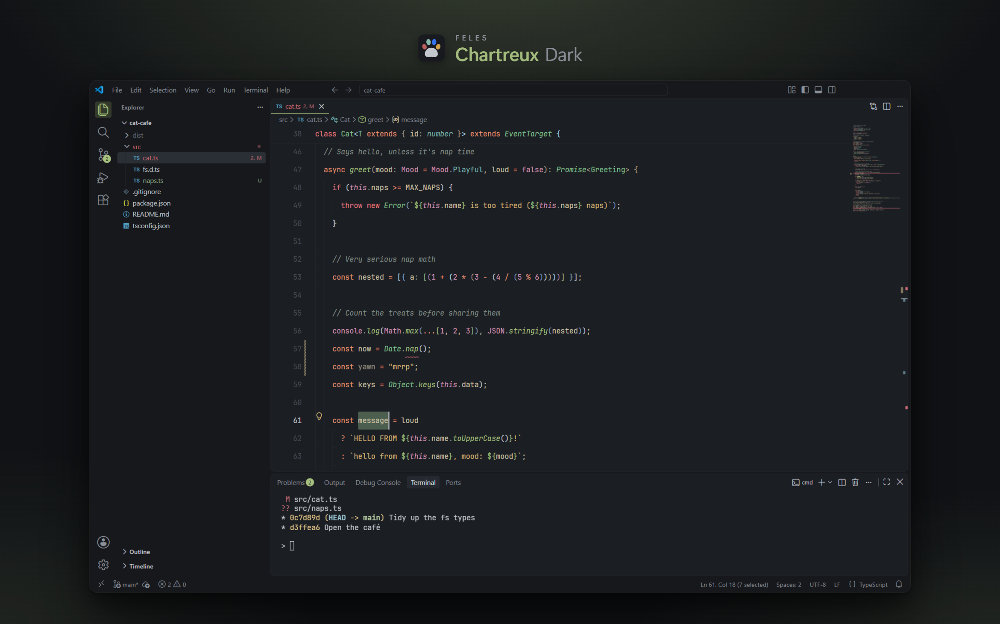

#### Feles Chartreux Light

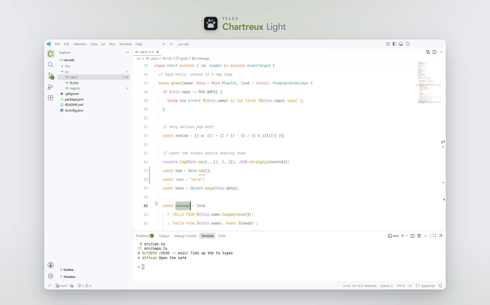

#### Feles Tuxedo Dark

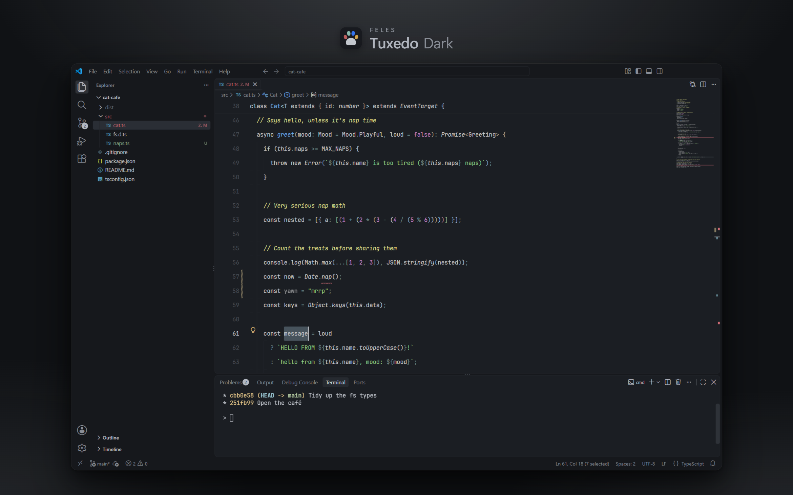

#### Feles Tuxedo Light

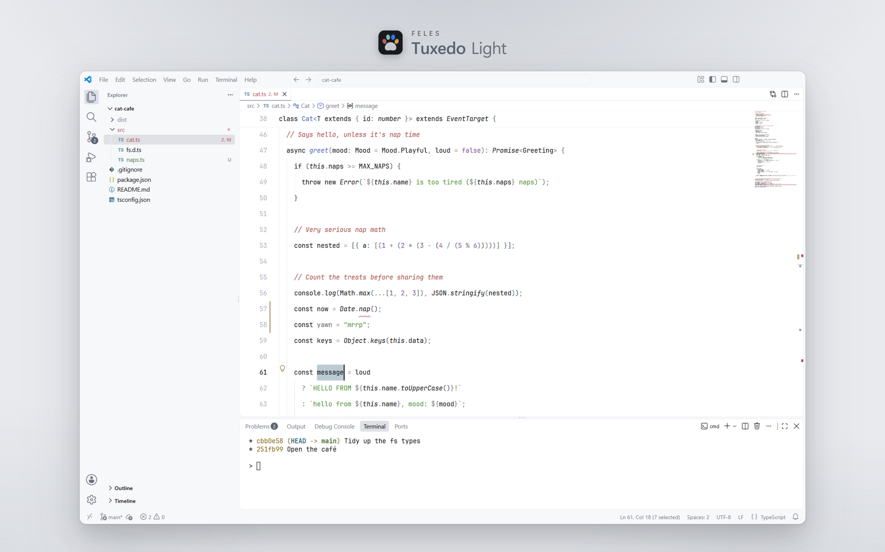
